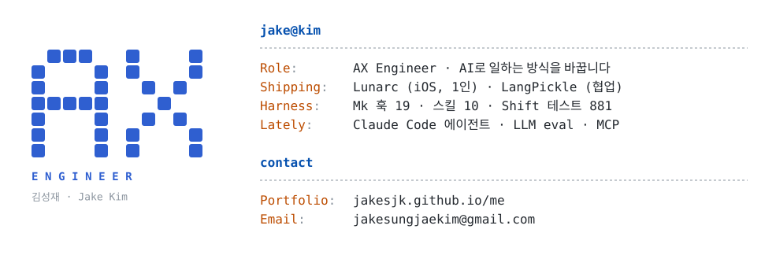
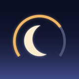
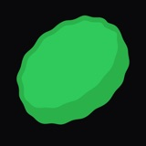
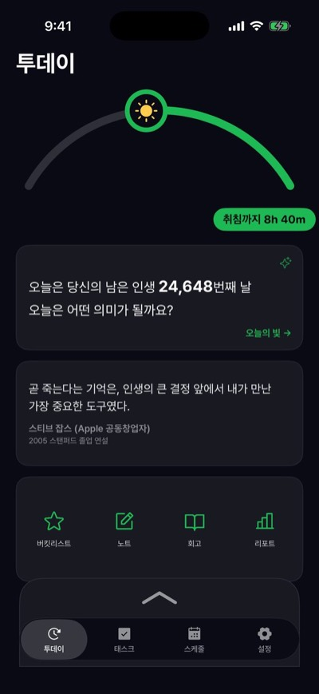
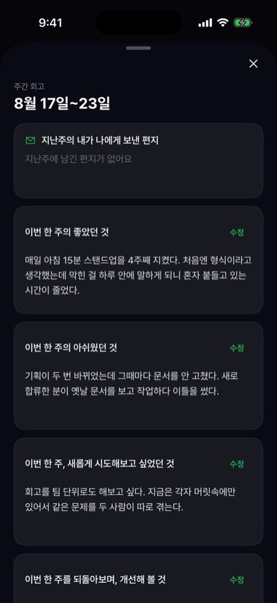
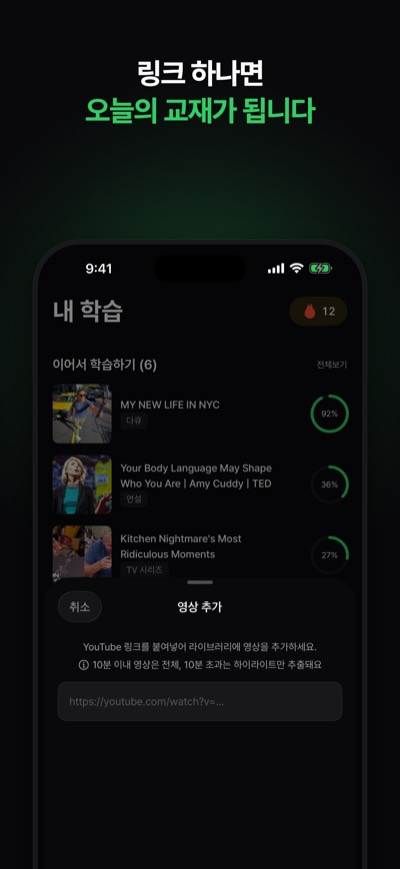
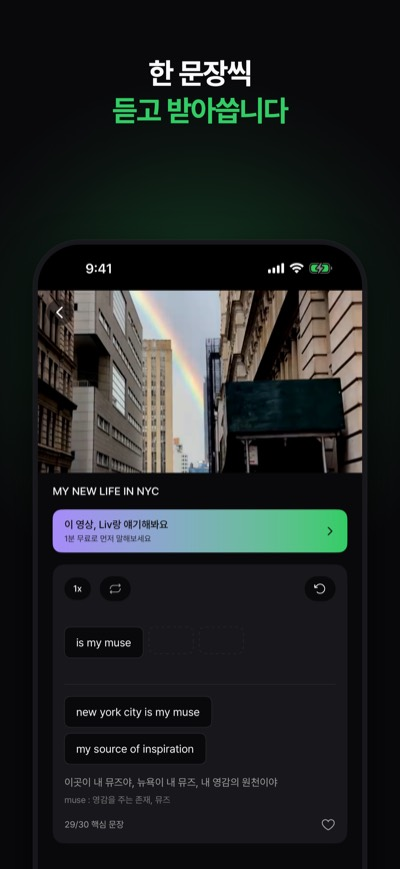
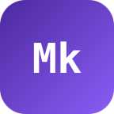
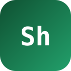

<picture>
  <source media="(prefers-color-scheme: dark)" srcset="assets/card-v2-dark.svg">
  
</picture>

   

### 📱 Shipped

<table>
<tr>
<th width="50%">&nbsp; <a href="https://jakesjk.github.io/me/projects/lunarc/">Lunarc</a></th>
<th width="50%">&nbsp; <a href="https://jakesjk.github.io/me/projects/langpickle/">LangPickle</a></th>
</tr>
<tr>
<td align="center"> </td>
<td align="center"> </td>
</tr>
<tr>
<td>시간 블록으로 하루를 설계하는 iOS 앱 기획부터 출시 · 운영까지 1인    <a href="https://apps.apple.com/kr/app/id6769979902">App Store →</a> </td>
<td>영상으로 배우는 언어 학습 앱 · 협업 출시 책임자로 1.0과 1.1.0 출시    <a href="https://apps.apple.com/kr/app/id6799830099">App Store →</a> </td>
</tr>
</table>

### 🧩 Agent Harness

<table>
<tr>
<td width="50%" valign="top">&nbsp; <b><a href="https://jakesjk.github.io/me/projects/mk/">Mk</a></b> 규칙을 훅으로 집행하는 개인 하네스      </td>
<td width="50%" valign="top">&nbsp; <b><a href="https://jakesjk.github.io/me/projects/shift/">Shift</a></b> 여러 에이전트가 레포 기록으로 교대하는 하네스     </td>
</tr>
</table>

### 🛠 Stack

<table>
<tr><td><b>Frontend</b></td><td>     </td></tr>
<tr><td><b>iOS</b></td><td>  </td></tr>
<tr><td><b>AI</b> </td><td>    </td></tr>
</table>

제품 코드 저장소는 비공개입니다. 판단과 검증 과정은 <a href="https://jakesjk.github.io/me/work/">포트폴리오 해결 사례</a>에 정리했습니다.
